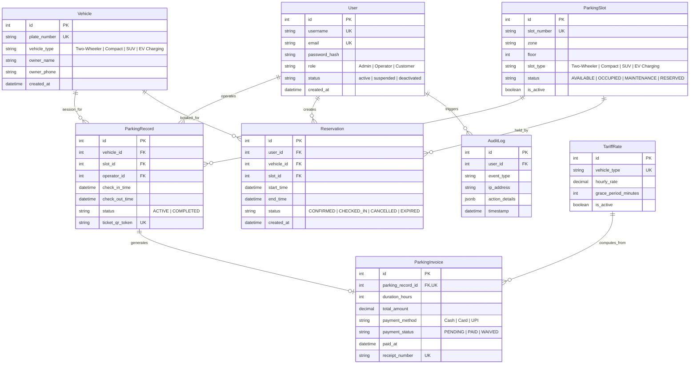

# Software Architecture Document (SAD) — Vehicle Parking System

**Project:** Vehicle Parking System (SE Mini-Project)  
**Repository:** `Vehicle-Parking-System-Team/Vehicle-Parking-System-SE-MINI-PROJECT`  
**Document Version:** 1.1.0 (Harmonized Development Baseline)  
**Document Author / Architect:** Member 2 (Facility & Availability Architecture Lead)  
**Integration Lead & Scrum Master:** Member 1  
**Baseline Date:** October 2026  
**Status:** Authoritative Architectural Baseline (Harmonized with SRS v1.1, RTM v1.1, Test Plan v1.0, and 32 User Stories)

---

## 1. Introduction

### 1.1 Purpose
This Software Architecture Document (SAD) provides a comprehensive architectural overview of the **Vehicle Parking System**. It captures the system's structural patterns, component responsibilities, data models, interface definitions, security controls, and runtime behaviors required to implement the 30 agreed Functional Requirements (`FR-01` to `FR-30`), 11 Non-Functional Requirements (`NFR-PERF-01..03`, `NFR-SAFE-01..03`, `NFR-SEC-01..07`), and 32 canonical User Stories (`US-01` to `US-32`).

### 1.2 Scope & System Boundaries
The Vehicle Parking System is a multi-tier, modular web application designed for automated parking facility operations. The core software scope encompasses:
- User registration, JWT-based authentication, and Role-Based Access Control (`Admin`, `Operator`, `Customer`).
- Vehicle registration, search, and historical session inspection.
- Parking slot and zone lifecycle management with real-time bay availability tracking.
- Advance parking reservation scheduling, conflict detection, and automated expiry release.
- Operator-driven vehicle check-in and check-out with automatic slot allocation and release.
- Anti-passback enforcement (single active session constraint per vehicle and per slot).
- Configurable tariff modeling, automated fee computation with a 15-minute grace period, and multi-method payment recording (`Cash`, `Card`, `UPI`).
- Digital parking slip and QR token issuance.
- Facility occupancy dashboards, administrative reporting with CSV/PDF exports, in-app notifications, and immutable security audit logging.

#### Explicit Out-of-Scope Enterprise Extensions
To maintain development integrity for the software engineering mini-project boundaries, physical site IoT hardware dependencies are formally decoupled from the application software layer:
- **Automated Physical Boom Barriers & Loop Detectors:** The core software workflow provides operator-driven verification and digital slips. Physical barrier relay hardware integrations are classified as post-MVP enterprise extensions.
- **Automated Number Plate Recognition (ANPR) Cameras:** Video feed optical character recognition (OCR) and camera hardware integrations are decoupled; operators capture or search license plates via web interfaces.
- **Third-Party Merchant Payment Gateway Production Integration:** Live commercial merchant banking (e.g., Razorpay/Stripe live webhooks) requires external corporate entity KYC. Core implementation operates with verified operator payment status recording.
- **Multi-Facility Distributed Federation & Offline Mesh Sync:** The application is architected as a centralized modular monolith backed by PostgreSQL; distributed edge replication is an enterprise roadmap proposal.

### 1.3 Target Audience
- **Software Engineers & Backend Developers:** To construct Django apps, DRF views, serializers, database migrations, and service-layer business rules.
- **Frontend Engineers:** To construct the React SPA, routing guards, state management, and operational dashboards.
- **Test & QA Engineers:** To map architectural components to test cases defined in the Software Test Plan (`TC-UCxx-...`).
- **Scrum Master & Integration Lead:** To track sprint backlog deliverables across Sprints 1 through 4.

### 1.4 Terminology & Definitions
- **Admin:** System administrator with full privileges to configure tariffs, manage user accounts, inspect audit trails, and oversee facility bays.
- **Operator:** Staff member operating entry/exit terminals, responsible for registering walk-in vehicles, checking vehicles in/out, verifying slips, and recording payments.
- **Customer:** Authenticated user with self-service privileges to view real-time occupancy, book advance reservations, view parking history, and manage personal profile.
- **Parking Bay / Slot:** An individual demarcated physical bay assigned a unique identifier, zone, floor, and vehicle class constraint (`Two-Wheeler`, `Compact`, `SUV`, `EV Charging`).
- **Active Session:** A parking session in progress where an allocated slot is `OCCUPIED` and the vehicle has checked in but not yet checked out.
- **Anti-Passback:** Validation rule preventing a vehicle from entering or being allocated a second slot while an active session exists (`FR-06`).
- **QR Token:** Digital session identifier encoded as a QR code and displayed on digital parking slips for rapid exit scanning (`FR-25`).

---

## 2. Document Governance & Canonical Traceability

This document supersedes all preliminary architectural drafts and aligns strictly with the project baseline:
1. **Software Requirements Specification (SRS v1.1):** Defines functional requirements `FR-01` to `FR-30` and decisions `DEC-01` to `DEC-15`.
2. **Requirements Traceability Matrix (RTM v1.1.0):** Maps all requirements to Epics E1–E8, Stories US-01–US-32, and Test Plan cases.
3. **Software Test Plan (v1.0):** Authoritative test cases `TC-UC01-UNIT-001` through `TC-SEC-002`.
4. **Live GitHub Backlog:** 8 Epics (#2, #15, #16, #17, #18, #19, #20, #21) and 32 User Stories (#1, #22–#52).

---

## 3. System Architecture

### 3.1 Architectural Goals & Quality Attributes
1. **Maintainability & Modular Separation:** Employ a clean Modular Monolith architecture on the backend, organizing code by functional domains (`accounts`, `vehicles`, `slots`, `reservations`, `operations`, `billing`, `reports`, `common`, `notifications`).
2. **Strict Concurrency & ACID Integrity:** Enforce atomic transactional integrity during check-in, check-out, and reservation booking. Use database row-level locking (`select_for_update()`) to ensure zero double-booking under concurrent load (`NFR-PERF-02`, `NFR-SAFE-01..03`).
3. **Stateless Security:** Leverage JSON Web Tokens (JWT) with short-lived access tokens (15 min) and persistent refresh tokens (7 days) with server-side revocation on logout (`NFR-SEC-01`, `NFR-SEC-05`).
4. **Auditability & Traceability:** Maintain an append-only, immutable audit trail for administrative actions, security transitions, overrides, and cancellations (`NFR-SEC-07`).

### 3.2 Technology Stack
- **Frontend Client:** React 18 SPA, Vite build pipeline, Tailwind CSS, Lucide icons, React Router DOM, Axios HTTP client.
- **Backend Application:** Python 3.11+, Django 4.2+ LTS, Django REST Framework (DRF) 3.14+, `djangorestframework-simplejwt` 5.x.
- **Database Engine:** PostgreSQL 15+ (production/staging) / SQLite3 (local development scaffolding).
- **Communication Protocol:** RESTful JSON over HTTPS, standardized error schemas (`{error, code, details}`).

### 3.3 Architecture Overview Diagram

```
+-----------------------------------------------------------------------------------+
|                           PRESENTATION LAYER (React SPA)                          |
|  +--------------------+  +---------------------+  +----------------------------+  |
|  | Operator Workspace |  |  Customer Portal    |  |  Admin Analytics Dashboard |  |
|  | (Entry/Exit/Slips) |  | (Reservations/Map)  |  |  (Tariff/Users/Audit Logs) |  |
|  +--------------------+  +---------------------+  +----------------------------+  |
|             |                       |                            |                |
|             +-----------------------+----------------------------+                |
|                                     | HTTP/REST (JSON + Bearer JWT)               |
+-------------------------------------v---------------------------------------------+
|                        APPLICATION / SERVICE LAYER (Django / DRF)                 |
|  +-----------------------------------------------------------------------------+  |
|  | API Gateway & Security: CORS, JWT Auth, Permission Guards (Admin/Oper/Cust) |  |
|  +-----------------------------------------------------------------------------+  |
|       |              |             |              |             |             |   |
|  +---------+   +----------+   +----------+   +----------+   +-------+   +-----+--+|
|  | Auth &  |   | Vehicle  |   |  Slots & |   | Reserv-  |   | Oper- |   | Billing||
|  | Users   |   | Mgmt     |   |  Zones   |   | ations   |   | ations|   | & Rates||
|  | (§3.4.2)|   | (§3.4.3) |   | (§3.4.4) |   | (§3.4.7) |   |§3.4.5)|   |(§3.4.6)||
|  +---------+   +----------+   +----------+   +----------+   +-------+   +-----+--+|
|       |              |             |              |             |             |   |
|  +-----------------------------------------------------------------------------+  |
|  | Cross-Cutting: Input Validation (§3.4.9), Audit Log, Exception Envelope     |  |
|  +-----------------------------------------------------------------------------+  |
+-------------------------------------v---------------------------------------------+
|                      PERSISTENCE & DATA LAYER (PostgreSQL 15+)                    |
|  +-----------------------------------------------------------------------------+  |
|  | Tables: users, vehicles, slots, reservations, records, tariffs, bills, audit|  |
|  | Constraints: Unique Active Slot, Unique Active Vehicle, Foreign Keys, ACID  |  |
|  +-----------------------------------------------------------------------------+  |
+-----------------------------------------------------------------------------------+
```

### 3.4 Component Descriptions & Module Architecture

#### 3.4.1 User Interface Component (React SPA)
- Renders high-speed operational views for Operators (rapid vehicle check-in, search, digital slip issuance, check-out fee display).
- Renders customer booking portal (visual bay map, advance reservation form, active slip display).
- Renders executive admin portal (occupancy gauges, revenue trends, user management, audit logs).
- Manages client-side token storage in memory / secure storage with auto-refresh interceptors.

#### 3.4.2 Authentication & Authorization Module (`backend/accounts/`)
- Manages identity verification via JWT token pairs (`FR-15`).
- Enforces Role-Based Access Control (`Admin`, `Operator`, `Customer`) across DRF endpoints and React navigation (`FR-16`).
- Admin user account administration: activate, suspend, deactivate (`FR-17`).
- User self-service profile updates and secure password change with PBKDF2 hashing (`FR-18`).
- Enforces public registration privilege safeguard: public registrations create `Customer` accounts only (`DEC-13`).

#### 3.4.3 Vehicle Management Module (`backend/vehicles/`)
- Registers vehicles with license plate, vehicle class (`Two-Wheeler`, `Compact`, `SUV`, `EV Charging`), and owner info (`FR-01`).
- Provides vehicle profile inspection and detail updates (`FR-02`).
- Provides instant search by license plate returning vehicle details and active parking status (`FR-11`).
- Enforces license plate format normalization (alphanumeric, uppercase, whitespace trimmed) and duplicate prevention.

#### 3.4.4 Parking Slot Allocation Engine (`backend/slots/`)
- Manages slots and zones: add, modify properties, and deactivate bays (`FR-03`).
- Tracks real-time bay availability status: `AVAILABLE`, `OCCUPIED`, `MAINTENANCE`, `RESERVED` (`FR-04`, `DEC-02`).
- Enforces soft deactivation (`is_active=False`) for bays with historical session references (`DEC-03`, `BR-07`).
- Executes semi-automated slot allocation recommending the nearest compatible available slot matching the vehicle class (`DEC-04`, `FR-05`).
- Protects occupied or maintenance bays from duplicate assignment (`FR-07`).
- Powers real-time occupancy status dashboard (`FR-10`).

#### 3.4.5 Parking Operations Module (`backend/operations/`)
- Orchestrates check-in: verifies active session uniqueness, assigns compatible slot, transitions bay to `OCCUPIED`, creates active `ParkingRecord`, and generates entry slip (`FR-05`).
- Enforces anti-passback constraint: rejects check-in if vehicle already has an active session (`FR-06`, `BR-01`).
- Orchestrates check-out: locates active record, records check-out timestamp, transitions session to completed, and computes duration (`FR-08`).
- Automatically restores bay status to `AVAILABLE` upon checkout (`FR-09`, `BR-04`).
- Retains immutable historical parking records for reporting and auditing (`FR-12`, `BR-05`).

#### 3.4.6 Billing & Pricing Module (`backend/billing/`)
- Configures vehicle-class tariff schedules: hourly base rates, initial flat-rate durations, and weekend multipliers (`FR-23`).
- Automated fee computation: evaluates 15-minute entry grace period (0 fee if exit <= 15 min), applies vehicle-class rate, and rounds up to next full hour (`FR-24`, `DEC-06`).
- Development baseline defaults: Two-Wheeler: ₹20/hr; Compact: ₹40/hr; SUV: ₹60/hr (`DEC-06`, `DEC-07`). Currency is `INR` (`₹`).
- Digital parking slip and QR token issuance: encodes `{sessionId, vehiclePlate, slotNumber, checkInTime, signature}` (`FR-25`, `DEC-08`).
- Payment transaction recording: records `Cash`, `Card`, or `UPI` method with operator confirmation and receipt issuance (`FR-26`, `DEC-07`).

#### 3.4.7 Reservation Module (`backend/reservations/`)
- Advance reservation creation: allows customers to reserve a compatible bay up to 7 days ahead for a defined future window (`FR-19`, `DEC-15`).
- Prevents scheduling conflicts: rejects reservations where the bay is already committed for an overlapping window (`FR-20`).
- Reservation modification and cancellation: permits customer cancellation up to 1 hour prior to reservation start time (`FR-21`, `DEC-15`).
- Check-in integration & auto-expiry: links valid reservation to arriving check-in; unfulfilled reservations expire 15 minutes past start time and release bay (`FR-22`, `DEC-15`).

#### 3.4.8 Reporting & Analytics Module (`backend/reports/`)
- Provides admin dashboard metrics: live occupancy rate, active session count, today's revenue, and bay turnover (`FR-27`).
- Historical reporting: generates occupancy, throughput, and revenue reports filtered by date range and vehicle class (`FR-28`).
- Export engine: exports structured reports in CSV and PDF formats (`FR-28`).

#### 3.4.9 Audit, Notifications & Common Component (`backend/common/`, `backend/notifications/`)
- Server-side payload validation: validates all incoming client parameters, rejecting malformed input with HTTP 400 (`FR-13`, `NFR-SEC-03`).
- Uniform structured error responses: wraps errors in `{error, code, details}` schema (`FR-14`).
- Security & event audit logging: appends immutable log entries for user status changes, manual overrides, cancellations, and tariff updates; 90-day retention (`FR-29`, `DEC-12`).
- In-app notification delivery: dispatches alerts for reservation confirmations, expiry warnings, and payment receipts (`FR-30`).

---

### 3.5 Traceability Matrix to Canonical System Requirements

The table below reconciles the architecture components with the canonical baseline:

| Req ID | Canonical Requirement Title | Epic & Story Mapping | Architectural Component | Planned Target File Paths | Test Plan Case ID |
| :--- | :--- | :--- | :--- | :--- | :--- |
| **FR-01** | Vehicle Registration | E2 / US-05 (#25) | Vehicle Management Module (§3.4.3) | `backend/vehicles/models.py`<br>`frontend/src/pages/Vehicles.jsx` | `TC-UC02-UNIT-001`<br>`TC-UC02-API-001` |
| **FR-02** | Vehicle Profile & Update | E2 / US-06 (#26) | Vehicle Management Module (§3.4.3) | `backend/vehicles/views.py`<br>`frontend/src/pages/Vehicles.jsx` | `TC-UC02-API-002` |
| **FR-03** | Slot & Zone Lifecycle | E3 / US-09 (#29) | Slot Allocation Engine (§3.4.4) | `backend/slots/models.py`<br>`frontend/src/pages/Slots.jsx` | `TC-UC03-UNIT-001` |
| **FR-04** | Real-Time Slot State Management | E3 / US-10 (#30) | Slot Allocation Engine (§3.4.4) | `backend/slots/services.py` | `TC-UC03-INT-001` |
| **FR-05** | Check-In & Slot Allocation | E5 / US-17 (#37) | Operations Module (§3.4.5) | `backend/operations/views.py` | `TC-UC05-UNIT-001`<br>`TC-UC05-INT-001` |
| **FR-06** | Single Active Session Constraint | E5 / US-18 (#38) | Operations Module (§3.4.5) | `backend/operations/services.py` | `TC-UC05-INT-002` |
| **FR-07** | Occupied Slot Protection | E3 / US-12 (#32) *(Owner: Member 4 [reassigned from Member 2])*<br>E5 / US-17 (#37) *(Owner: Member 3)* | Slot Engine & Operations (§3.4.4, §3.4.5) | `backend/operations/services.py` | `TC-UC03-SYS-002`<br>`TC-UC05-INT-001` |
| **FR-08** | Vehicle Check-Out Operations | E5 / US-19 (#39) | Operations Module (§3.4.5) | `backend/operations/views.py` | `TC-UC06-INT-001` |
| **FR-09** | Automatic Slot Release | E5 / US-19 (#39) | Operations Module (§3.4.5) | `backend/operations/services.py` | `TC-UC06-INT-002` |
| **FR-10** | Live Occupancy Dashboard | E3 / US-11 (#31) *(Owner: Member 4 [reassigned from Member 2])* | Slot Allocation Engine (§3.4.4) | `frontend/src/pages/Dashboard.jsx` | `TC-UC03-SYS-002` |
| **FR-11** | Search Vehicle by License Plate | E2 / US-07 (#27) | Vehicle Management Module (§3.4.3) | `backend/vehicles/views.py`<br>`frontend/src/pages/Search.jsx` | `TC-UC02-API-001`<br>`TC-UC02-API-002` |
| **FR-12** | Persistent Parking History Trail | E5 / US-20 (#40) | Operations Module (§3.4.5) | `backend/operations/models.py`<br>`frontend/src/pages/History.jsx` | `TC-UC06-SYS-001` |
| **FR-13** | Server-Side Input Validation | E2 / US-08 (#28)<br>E8 / US-31 (#51) | Common Validation Layer (§3.4.9) | `backend/common/serializers.py` | `TC-UC10-API-001` |
| **FR-14** | Uniform Structured Error Responses | E2 / US-08 (#28)<br>E8 / US-31 (#51) | Common Exception Layer (§3.4.9) | `backend/common/exceptions.py` | `TC-UC10-API-001` |
| **FR-15** | User Authentication & Logout | E1 / US-01 (#1) | Security & IAM Module (§3.4.2) | `backend/accounts/views.py`<br>`frontend/src/context/AuthContext.jsx` | `TC-UC01-UNIT-001`<br>`TC-UC01-SYS-001` |
| **FR-16** | Role-Based Access Control (RBAC) | E1 / US-02 (#22) | Security & IAM Module (§3.4.2) | `backend/accounts/permissions.py`<br>`frontend/src/routes/ProtectedRoute.jsx` | `TC-UC01-API-002` |
| **FR-17** | User Account Administration | E1 / US-03 (#23) | Security & IAM Module (§3.4.2) | `backend/accounts/views.py` | `TC-UC04-API-001` |
| **FR-18** | Profile & Password Management | E1 / US-04 (#24) | Security & IAM Module (§3.4.2) | `backend/accounts/serializers.py`<br>`frontend/src/pages/Profile.jsx` | `TC-UC04-API-002`<br>`TC-UC04-SYS-001` |
| **FR-19** | Advance Reservation Scheduling | E4 / US-13 (#33) | Reservation Module (§3.4.7) | `backend/reservations/models.py`<br>`frontend/src/pages/Reservations.jsx` | `TC-UC04-API-001` |
| **FR-20** | Prevent Reservation Conflicts | E4 / US-15 (#35) | Reservation Module (§3.4.7) | `backend/reservations/services.py` | `TC-UC04-SYS-001` |
| **FR-21** | Modify or Cancel Reservation | E4 / US-14 (#34) | Reservation Module (§3.4.7) | `backend/reservations/views.py` | `TC-UC04-API-001` |
| **FR-22** | Link Reservation & Auto-Release | E4 / US-16 (#36) | Reservation Module (§3.4.7) | `backend/reservations/services.py` | `TC-UC04-SYS-001` |
| **FR-23** | Tariff Rate Configuration | E6 / US-21 (#41) | Billing & Pricing Module (§3.4.6) | `backend/billing/models.py` | `TC-UC07-UNIT-001` |
| **FR-24** | Automated Fee Computation | E6 / US-22 (#42) | Billing & Pricing Module (§3.4.6) | `backend/billing/services.py` | `TC-UC07-API-002` |
| **FR-25** | Digital Slip & QR Token | E6 / US-23 (#43) | Billing & Pricing Module (§3.4.6) | `backend/billing/services.py` | `TC-UC07-SYS-001` |
| **FR-26** | Payment Status Recording | E6 / US-24 (#44) | Billing & Pricing Module (§3.4.6) | `backend/billing/views.py` | `TC-UC08-SYS-001` |
| **FR-27** | Admin Dashboard Summary Metrics | E7 / US-25 (#45) | Reporting & Analytics (§3.4.8) | `frontend/src/pages/AdminDashboard.jsx` | `TC-UC08-API-001` |
| **FR-28** | Occupancy & Revenue Reports | E7 / US-26..28 (#46..48) | Reporting & Analytics (§3.4.8) | `backend/reports/views.py`<br>`frontend/src/pages/Reports.jsx` | `TC-UC08-API-002`<br>`TC-UC08-SYS-001` |
| **FR-29** | System Security Audit Log | E8 / US-29 (#49) | Common Audit Layer (§3.4.9) | `backend/common/models.py` | `TC-UC09-INT-001`<br>`TC-UC09-SYS-001` |
| **FR-30** | In-App Milestone Notifications | E8 / US-30 (#50) | Notification Module (§3.4.9) | `backend/notifications/models.py`<br>`frontend/src/components/Notifications.jsx` | `TC-UC09-SYS-002` |

---

## 4. System Design & Data Models

### 4.1 Relational Data Model (PostgreSQL Schema)

The domain data model is organized into cohesive Django app models with strict referential constraints:



### 4.2 Core Operational Sequences

#### 4.2.1 Check-In & Slot Assignment Workflow (`FR-05`, `FR-06`, `FR-07`, `FR-25`)
1. **Request:** Operator inputs license plate and vehicle type into Operator Workspace.
2. **Session Uniqueness Check:** Operations service queries `ParkingRecord` for `vehicle_id` with `status='ACTIVE'`. If found, transaction aborts with HTTP 409 conflict (`FR-06`, anti-passback).
3. **Slot Allocation:** Slot engine queries `ParkingSlot` with `status='AVAILABLE'`, `is_active=True`, and `slot_type == vehicle.vehicle_type`. Acquires row lock using `SELECT ... FOR UPDATE`.
4. **State Transition & Record Creation:**
   - Bay status updated to `OCCUPIED`.
   - `ParkingRecord` inserted with entry timestamp and unique QR token payload.
5. **Slip Generation:** Service returns digital parking slip containing session ID, bay label, entry timestamp, and QR token.

#### 4.2.2 Check-Out, Fee Evaluation & Slot Release (`FR-08`, `FR-09`, `FR-24`, `FR-26`)
1. **Request:** Operator scans QR token or enters license plate at exit terminal.
2. **Active Record Lookup:** Operations service fetches active `ParkingRecord` with row lock.
3. **Fee Evaluation:**
   - Calculates duration = `checkout_time - check_in_time`.
   - Evaluates 15-minute grace period (`DEC-06`): if duration <= 15 minutes, fee = ₹0.
   - Otherwise, rounds duration up to next full hour and multiplies by vehicle-class tariff (`DEC-06`, `DEC-07`).
4. **Payment Recording:** Operator records payment method (`Cash`, `Card`, `UPI`) and marks invoice `PAID`.
5. **Slot Release & Session Close:**
   - `ParkingRecord` status set to `COMPLETED` with checkout timestamp.
   - `ParkingSlot` status immediately set to `AVAILABLE`.
   - Digital receipt issued to customer.

---

## 5. Security & Error Handling Architecture

### 5.1 Authentication, Tokens & Password Policies (`DEC-09`, `DEC-10`, `DEC-13`)
- **Access Tokens:** Stateless JWT with 15-minute lifetime containing `{user_id, username, role}`.
- **Refresh Tokens:** 7-day lifetime stored securely; refresh endpoint issues new access token.
- **Logout Invalidation:** Logout endpoint adds refresh token to database blacklist table; revoked tokens rejected on reuse.
- **Password Hashing:** Passwords hashed using Django default PBKDF2 with SHA-256 (`NFR-SEC-05`).
- **Complexity Enforcer:** Passwords must have >= 8 characters, >= 1 uppercase, >= 1 lowercase, >= 1 digit, >= 1 special character.
- **Privilege Safeguard:** Public registration creates `Customer` accounts only. Elevation to `Operator` or `Admin` requires an existing Administrator (`NFR-SEC-02`, `DEC-13`).

### 5.2 Standard Error Response Schema (`FR-14`)
All application exceptions and DRF validation failures conform to the standardized error envelope:
```json
{
  "error": "ConflictError",
  "code": "ACTIVE_SESSION_EXISTS",
  "message": "Vehicle KA-01-AB-1234 already has an active parking session.",
  "details": {
    "vehicle_plate": "KA-01-AB-1234",
    "active_slot": "A-102"
  }
}
```

---

## 6. Implementation Target Status & Project Roadmap

### 6.1 Scaffolded Baseline vs. Planned Module Locations
The current repository baseline contains the verified architectural foundation:
- `backend/config/`: Django project settings, ASGI/WSGI, root URL routing, and dependencies (`manage.py`, `requirements.txt`).
- `frontend/src/`: React 18 application scaffold (`App.jsx`, `main.jsx`, `index.css`, `vite.config.js`).

All application domain modules (`backend/accounts/`, `backend/vehicles/`, `backend/slots/`, `backend/reservations/`, `backend/operations/`, `backend/billing/`, `backend/reports/`, `backend/common/`, `backend/notifications/`) and frontend page views are **planned Sprint 1 / Sprint 2 implementation targets** to be developed during the upcoming backlog implementation phase.

### 6.2 External Dependencies & Post-MVP Scope
1. **Commercial Production Tariff Rate Schedule (`FR-23`):** Production rate approval rests with facility management. The development baseline executes with nominal defaults (₹20 Two-Wheeler, ₹40 Compact, ₹60 SUV).
2. **Production Merchant Gateway Integration (`FR-26`):** Live merchant processing credentials depend on external banking KYC. Sprint implementation operates with operator-verified payment recording.
3. **Automated Barrier & ANPR Hardware (`SAD §1.2`):** Physical gate relays, inductive loop detectors, and OCR camera feeds are decoupled from the software engineering scope as future enterprise hardware proposals.

---

## 7. Document Revision History

| Version | Date | Author / Role | Changes Description |
| :--- | :--- | :--- | :--- |
| **1.0.0** | 19 Oct 2026 | Member 2 (Architecture Lead) | Initial SAD draft PDF export (`Vehicle_Parking_System_SAD (2) (1) (1).pdf`). |
| **1.1.0** | 19 Oct 2026 | Member 1 & Member 2 | Harmonized SAD markdown baseline: corrected §3.8 traceability to canonical FR-01..30, aligned roles to Admin/Operator/Customer, eliminated hardware assumptions, formalized DEC-01..15, and reconciled with SRS v1.1 and Test Plan v1.0. |
| **1.1.1** | 25 Oct 2026 | Member 1 (Integration Lead) | Documented story ownership reassignment: US-11 (#31, FR-10) and US-12 (#32, FR-07) transferred from Member 2 to Member 4 due to Member 2 workload/availability constraints; Member 2 retains US-09, US-10 (Done) and Epic E4 (US-13..16); Member 4 assumes US-11, US-12 alongside Epics E7 and E8. |
