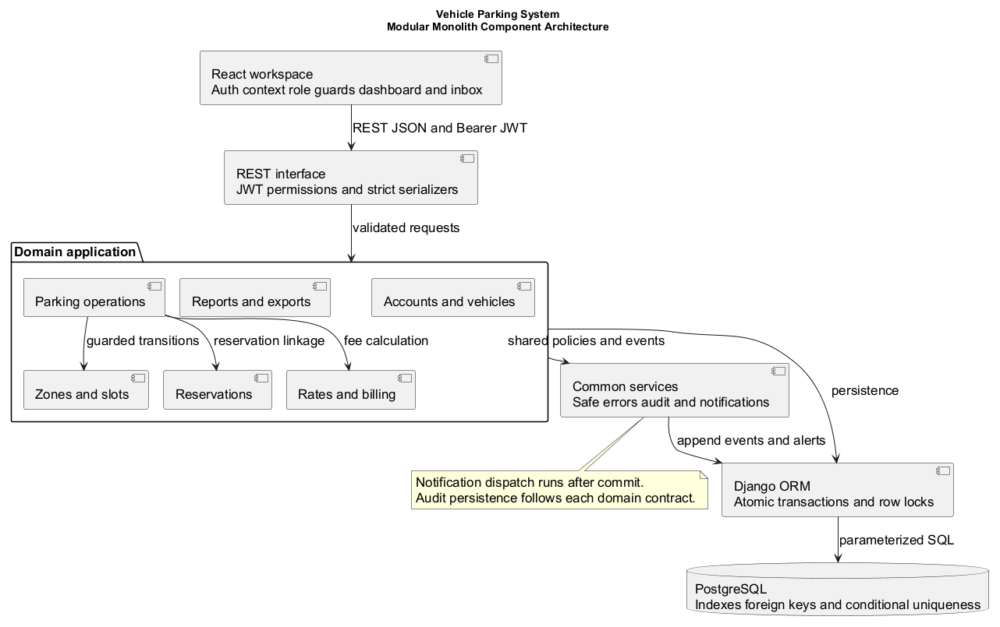
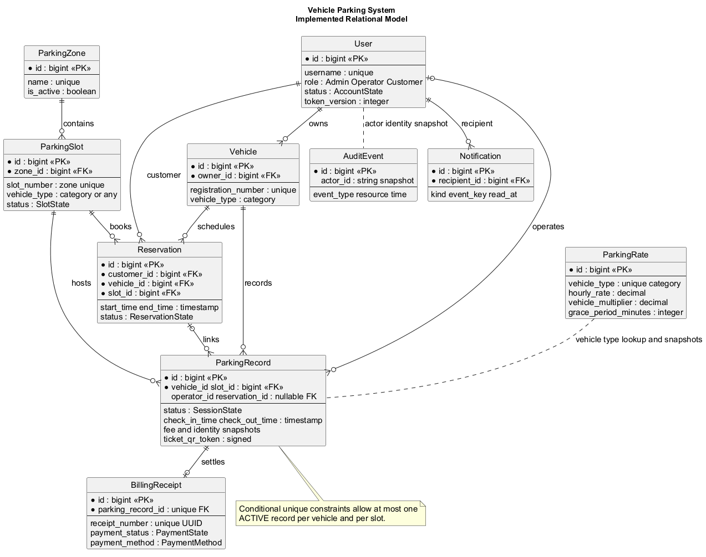
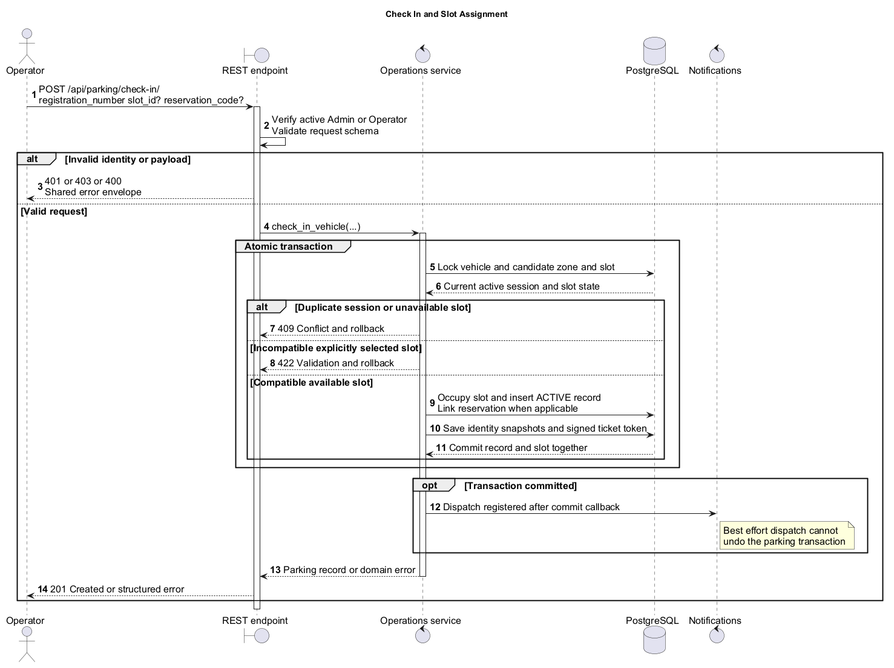
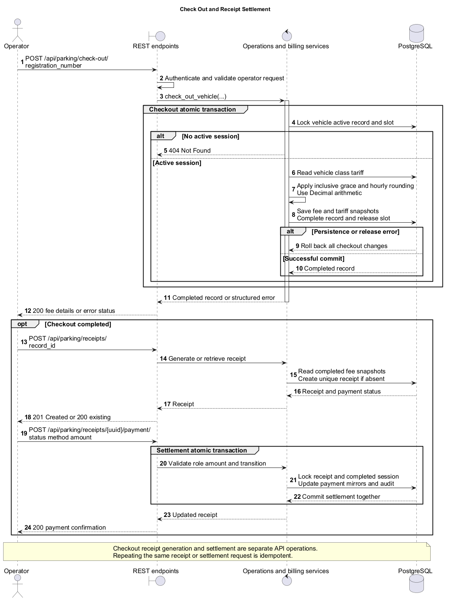
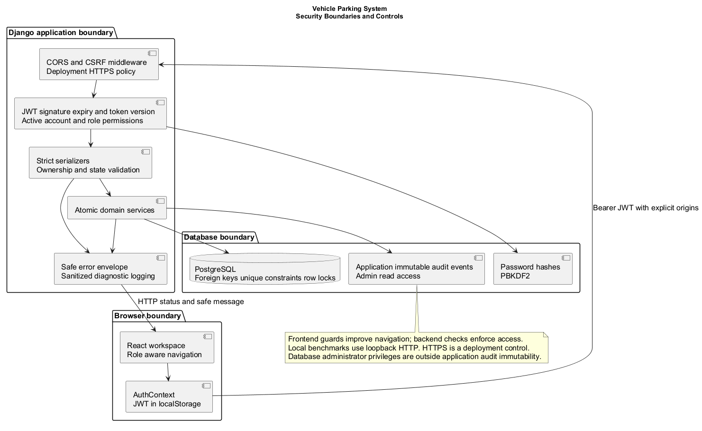

# Vehicle Parking System Software Architecture and Design Specification

Version 2.0 | 8 November 2026

Prepared by Vehicle Parking System Project Team

Application baseline: `0c883054fc84897bf303c3b766b60e0152fac1e9` with the measured vehicle-search batching refinement included in this delivery. Requirements, architecture, tests and the delivery register use the same canonical FR and NFR identifiers.

## 1 Introduction
### 1.1 Purpose and design conventions
This IEEE 1016 style design description explains the implemented architecture, domain model, runtime interactions, interfaces and security decisions. It serves developers, reviewers, testers and the evaluation team. The companion SRS defines requirements and the RTM connects them to code and tests.
### 1.2 Stakeholders and concerns
Customers need ownership protection and current availability. Operators need consistent entry/exit and settlement. Administrators need controlled configuration, reporting and auditability. Developers and testers need clear module contracts, deterministic fee rules and reproducible regression evidence.
## 2 Architecture
### 2.1 Pattern and rationale
The system uses a layered modular monolith. React owns presentation, Django apps own domain behavior, and PostgreSQL owns persistence integrity. This keeps cross-domain transactions inside one database while allowing each story to evolve behind a REST interface. PostgreSQL row locks and conditional unique constraints enforce allocation safety; React guards organize navigation without replacing server authorization.

### 2.2 Component responsibilities
| Component | Responsibility | Code |
| --- | --- | --- |
| Presentation | Auth context, role guards, vehicles, facility, profile/users, dashboard/export, inbox | frontend/src |
| Accounts | JWT and token revocation, active-account/role checks, self profile, administrative lifecycle | backend/accounts |
| Vehicles | Plate normalization, ownership, duplicate protection and batched live-state search | backend/vehicles |
| Facility | Zone/slot lifecycle, guarded state transitions, public availability | backend/parking_slots |
| Reservations | Booking window, modification/cancellation, lock order and conflict checks | backend/reservations |
| Operations | Atomic check-in/out, snapshots, signed ticket and completed history | backend/operations |
| Rates and billing | Decimal fee calculation, immutable receipt snapshots and recorded settlement | backend/rates; backend/billing |
| Reporting | Dashboard, occupancy, collected revenue and canonical CSV/PDF exports | backend/reports |
| Common and notifications | Shared errors, append-only audit and recipient-scoped best-effort alerts | backend/common; backend/notifications |

### 2.3 Runtime and deployment view
Local Vite proxies relative /api requests to Django. CI runs backend regression, PostgreSQL integrity, frontend checks and source/secret scans. Production configuration disables DEBUG, requires a secret key, redirects HTTP and restricts CORS/CSRF origins. A reverse proxy and real certificate are deployment concerns. The measured evaluation server is a threaded loopback WSGI process with DEBUG disabled.
### 2.4 Requirement traceability
Identity FR-15 through FR-18 maps to accounts; vehicles FR-01/02/11 to vehicles; facility FR-03/04/07/10 to parking_slots; reservations FR-19 through FR-22 to reservations; parking FR-05/06/08/09/12 to operations; pricing FR-23 through FR-26 to rates/billing; reporting FR-27/28 to reports; shared FR-13/14/29/30 to common and notifications. The RTM provides individual stories, owners, cases and evidence.
## 3 Data Design

### 3.1 Integrity and history
Vehicle identity has separator-insensitive database uniqueness. Slot number is unique within its zone. Conditional unique constraints prohibit multiple ACTIVE sessions per slot or vehicle. Foreign keys protect referenced parking entities. ParkingRecord snapshots preserve plate, slot, zone and tariff identity over later edits. BillingReceipt is one-to-one with a completed record. Monetary state uses Decimal; settlement updates receipt/session mirrors in one transaction.
### 3.2 Reservation and audit representation
Reservations store Confirmed, Cancelled or Fulfilled states; a passed grace window is evaluated as expiry without inventing an Expired database enum. AuditEvent stores actor identity as a snapshot string rather than a user foreign key, preserving attribution after source account changes. Notification uniqueness is per recipient/event_key and read_at tracks dismissal/read state.
## 4 Behavioral Design
### 4.1 Check in
The REST boundary validates identity and schema. Operations locks vehicle and candidate zone/slot rows, enforces active-session uniqueness and compatibility, persists occupied state and the ACTIVE record, links a valid reservation and signs the ticket. A transaction failure rolls back all state. Explicit incompatibility returns 422; duplicate/unavailable allocation returns 409.
### 4.2 Check out and settlement
Checkout locks the active record and slot, reads tariff, computes the fee, snapshots it, completes the record and releases the slot. No active record returns 404. Receipt generation is a later idempotent operation; payment recording is a separate atomic transition with amount/role validation and audit.
### 4.3 Search design
Exact plate identity uses the normalized expression index. Partial search caps results at 50 and scopes Customers to their own vehicles. Owner rows are joined; active sessions and their slot/zone are prefetched in one batch. A 25-result serialized page uses three queries rather than one status/owner lookup for each vehicle.

## 5 API Design
The table lists canonical routes. Optional aliases remain for existing clients. Protected requests use Authorization: Bearer with JSON bodies. Trailing slashes follow Django routing.
| Method | Route | Access and behavior |
| --- | --- | --- |
| POST | /api/auth/register/ | Public; creates Customer |
| POST | /api/auth/login/ | Public; active credentials return JWT pair |
| POST | /api/auth/token/refresh/ | Valid refresh token |
| POST | /api/auth/logout/ | Authenticated token revocation |
| GET PATCH | /api/auth/profile/ | Own profile |
| POST | /api/auth/password/change/ | Own current password and confirmed new password |
| GET POST PATCH | /api/auth/users/ and /api/auth/users/{id}/ | Admin account lifecycle |
| GET POST | /api/v1/vehicles/ | Authenticated registration/list |
| GET PUT PATCH | /api/v1/vehicles/{id}/ | Permitted vehicle owner/access |
| GET | /api/v1/vehicles/search/?plate= or ?q= | Admin/Operator any; Customer own |
| GET | /api/parking/availability/ | Public safe projection |
| GET POST PATCH DELETE | /api/parking/zones/ and /api/parking/slots/ | Admin/Operator; detail paths use {id}/ |
| PATCH | /api/parking/slots/{id}/status/ | Guarded facility transition |
| POST | /api/parking/reservations/ | Customer or Operator creation |
| PATCH DELETE | /api/parking/reservations/{id}/ | Active-account role/ownership and booking rules |
| POST | /api/parking/check-in/ | Admin/Operator; registration_number and optional slot_id/reservation_code |
| POST | /api/parking/check-out/ | Admin/Operator; registration_number only |
| GET | /api/parking/history/ | Admin/Operator; paginated filters |
| GET POST PUT PATCH | /api/v1/rates/ and {id}/ | Read permissions and Admin mutations per tariff contract |
| POST GET | /api/parking/receipts/ and {uuid}/ | Completed receipt and authorized read |
| GET | /api/parking/receipts/{uuid}/print/ | Authorized printable HTML |
| POST | /api/parking/receipts/{uuid}/payment/ | Admin/Operator settlement |
| GET | /api/reports/dashboard/ occupancy/ revenue/ | Admin; separate routes under /api/reports/ |
| GET | /api/reports/export/ | Admin; format/report/date filters |
| GET | /api/audit/ | Admin paginated audit reads |
| GET | /api/notifications/ | Authenticated recipient inbox |
| POST | /api/notifications/{id}/read/ | Mark own notification as read |

### 5.1 Request and response examples
Check-in request: {"registration_number":"KA-01-AB-1234","slot_id":1}. Success returns HTTP 201 and the persisted parking record with its signed ticket token. Checkout returns HTTP 200 and completed fee snapshots. Clients cannot supply the computed fee as checkout authority.

Receipt generation request: {"record_id":1}. It returns HTTP 201 on creation and HTTP 200 for the existing receipt. Settlement uses payment_status, payment_method and payment_amount. The payment contract in docs/design/US24-payment-contract.md defines permitted transitions.
### 5.2 Error handling protocol
All DRF exceptions use {"error":"safe message","code":"stable code","details":{}}. HTTP 400 identifies malformed input; 401 missing/invalid identity; 403 forbidden roles/ownership; 404 unknown resources or no active session; 409 conflicting state; 422 explicitly incompatible slot; 500 unexpected errors with a generic public message. Response headers and validation details are preserved. Direct Response objects are reviewed separately from the exception handler.
## 6 Security Architecture

Backend JWT validation checks signature, expiry, token_version and current account state. Permission classes and ownership checks protect each domain. CORS and CSRF are distinct controls. JWT localStorage storage is documented explicitly. Source/secret scans complement tests; application audit immutability does not represent protection against a database administrator. Unexpected errors are sanitized before reaching clients.
## 7 Design Decisions and Alternatives
The modular monolith provides simpler transactions than distributed services for this facility scope. PostgreSQL is the integrity acceptance engine; SQLite supports convenient development. Exact-class/any allocation and deterministic candidate ordering provide repeatable placement. Signed ticket tokens and manual plate input support software-operated entry/exit. Receipt creation and settlement remain separate to preserve idempotence and operator payment confirmation. Operational APIs and the available React screens are documented independently.
## 8 Verification and Revision History
The final verification report links regression execution, performance samples and the test catalogue. Version 2.0 updates implemented components/routes/data, adds editable UML sources, and documents measured query batching. Historical design PDFs remain archived for version history; this document and its matching PDF are the current design specification.
