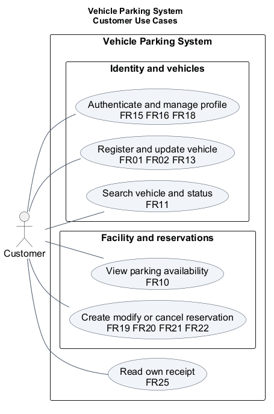
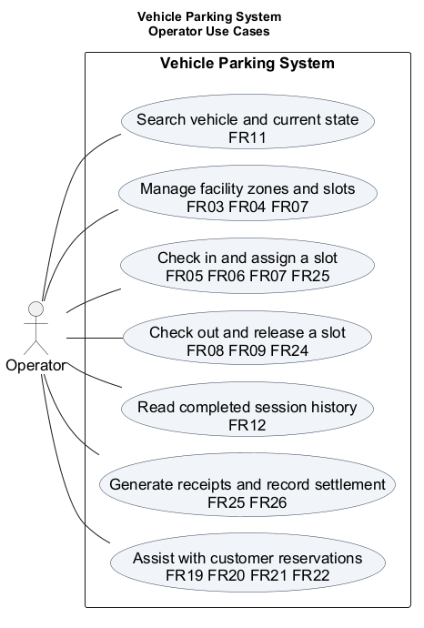
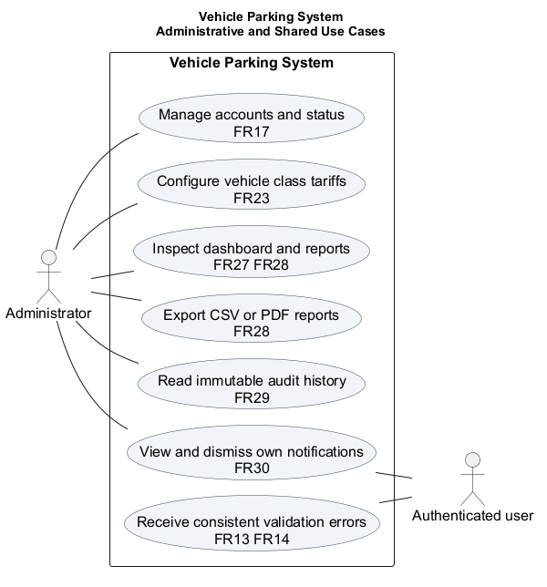

# Vehicle Parking System Software Requirements Specification

Version 2.0 | 8 November 2026

Prepared by Vehicle Parking System Project Team

Application baseline: `0c883054fc84897bf303c3b766b60e0152fac1e9` with the measured vehicle-search batching refinement included in this delivery. Requirements, architecture, tests and the delivery register use the same canonical FR and NFR identifiers.

## 1 Introduction
### 1.1 Purpose
This specification defines the parking application and its measurable acceptance criteria. It follows the course IEEE 830 style structure and the requirements information principles of ISO/IEC/IEEE 29148. The requirement IDs retain continuity with the original project baseline.
### 1.2 Product scope
The product supports vehicle registration, parking availability, reservations, operator entry/exit, billing records, administrative reporting and operational notifications. React presents the workspace; Django REST Framework enforces business rules; PostgreSQL preserves transactions and history.
### 1.3 Audience and definitions
Administrators manage accounts, tariffs and reports. Operators manage facility and parking operations. Customers manage their own profile, vehicles, reservations and receipt access. FR means functional requirement; NFR means non-functional requirement; RTM means requirements traceability matrix; JWT means JSON Web Token.
### 1.4 References
- ISO/IEC/IEEE 29148:2018 requirements engineering: https://www.iso.org/standard/72089.html
- IEEE 830 course format; IEEE 1016 design description: https://standards.ieee.org/ieee/1016/4502/
- Current SAD, Software Test Plan, RTM and final verification report in docs.
## 2 Overall Description
### 2.1 Product perspective
The application is a modular monolith with one relational database. Relative /api requests connect the React client to the backend. Frontend views cover identity, vehicle management, facility/availability, account administration, dashboard/export and notifications. Operational, reservation, history, tariff and billing workflows are available through their REST interfaces.
### 2.2 Operating environment
The verified local environment uses Windows, Python 3.12, Django 5.2 and PostgreSQL 18. CI uses Ubuntu, Python 3.13 and Node 22. The browser client targets current Chromium, Firefox and WebKit families; automated frontend evidence covers helper logic and production compilation. Browser release acceptance records its exact engine/version when exercised.
### 2.3 Constraints and dependencies
Money uses INR and Decimal arithmetic. Slot states are available, occupied, reserved and maintenance. Record states are ACTIVE and COMPLETED. Reservation states are Confirmed, Cancelled and Fulfilled. The database provides foreign keys, uniqueness and row locks. Environment variables supply secrets, origin policy and database settings.
### 2.4 User interfaces and role boundaries
Public availability exposes slot, zone, type and state. Authenticated Customers access their own vehicle and account information. Admin/Operator permissions protect facility and parking operations. Administrative reports, tariff management, user administration and audit reads have explicit backend permissions. Hiding a frontend action is a navigation convenience; authorization remains server-side.
## 3 External Interfaces
### 3.1 Software and communications interfaces
REST requests use JSON and Bearer JWT authentication. The endpoint register in the SAD specifies methods, paths and roles. Receipts have structured and printable HTML forms; reports export CSV and PDF. HTTP status and the error/code/details JSON envelope express failures consistently.
### 3.2 Data interfaces
Entity relationships appear in the SAD. A vehicle belongs to one user; a slot belongs to a zone; a session references a vehicle and slot and may link a reservation. Receipt and fee snapshots preserve completed financial history. Audit actor identity is a string snapshot, independent of later account changes.
## 4 Use Case Models
The diagrams separate customer/operator workflows from administrative and shared functions. Associations identify participation, while the permission register remains authoritative for role enforcement.

## 5 Functional Requirements
The following statements preserve FR-01 through FR-30. Each entry identifies its implementation and executable acceptance family; current implementation decisions are recorded in section 9.
### 5.1 Identity and access
#### FR-15
The system shall securely authenticate users, issue JWT token pairs (access and refresh), and support secure logout.

Release acceptance: Valid credentials return an access token and a refresh token (HTTP 200). Invalid credentials return HTTP 401 and no token is issued.

Verification: TC-AUTH-01.

#### FR-16
The system shall enforce Role-Based Access Control (RBAC) across Admin, Operator, and Customer roles.

Release acceptance: A protected function is accessible only to roles explicitly permitted for it. Unauthorized or unauthenticated requests are rejected with HTTP 401 or HTTP 403 (NFR-SEC-01).

Verification: TC-SEC-01.

#### FR-17
The system shall allow administrators to manage user accounts and user statuses (active, suspended, deactivated).

Release acceptance: An administrator can set a user account to active, suspended, or deactivated. Non-administrative attempts to modify user status return HTTP 403 (NFR-SEC-02).

Verification: TC-SEC-01.

#### FR-18
The system shall allow users to inspect their profile, update personal contact details, and securely change passwords.

Release acceptance: A user can view their stored profile attributes and update personal contact details. Password changes require validation against strong password rules.

Verification: TC-AUTH-02.

### 5.2 Vehicle management
#### FR-01
The system shall allow an authorized user/operator to register a vehicle with plate number, vehicle type, and owner information.

Release acceptance: A submission with plate number, vehicle type, and owner details creates a retrievable vehicle record. Missing or malformed mandatory fields are rejected with HTTP 400 (FR-13).

Verification: TC-VEH-01.

#### FR-02
The system shall allow an authorized user/operator to view and update vehicle profile and registration details.

Release acceptance: An authorized operator can view a stored vehicle record by ID or plate. A valid update is persisted and updates the last-modified timestamp.

Verification: TC-VEH-01.

#### FR-11
The system shall allow authorized users/operators to search for a vehicle by license plate and inspect its current parking status.

Release acceptance: Searching an existing license plate returns the vehicle and its current status (parked with slot, or not parked). A search with no match returns a structured not-found response (FR-14).

Verification: TC-VEH-03.

### 5.3 Facility and availability
#### FR-03
The system shall allow an authorized administrator/operator to add, modify, and deactivate parking slots and zones.

Release acceptance: An authorized user can create a slot with a unique identifier and assign it to a zone. An authorized user can modify slot properties or deactivate a slot/zone.

Verification: TC-SLOT-01.

#### FR-04
The system shall maintain the real-time status of each parking slot (Available, Occupied, Maintenance).

Release acceptance: Each slot has exactly one status at any time; stored states also include Reserved (DEC-02). Check-in sets the status to Occupied; check-out releases the slot to Available.

Verification: TC-SLOT-01.

#### FR-07
The system shall prevent an occupied or unavailable parking slot from being assigned to another vehicle.

Release acceptance: A check-in attempt targeting an Occupied or Maintenance slot is rejected with an error. Slot status and existing parking records remain unaltered.

Verification: TC-SLOT-02.

#### FR-10
The system shall provide a live parking occupancy status dashboard for operators and users.

Release acceptance: Public availability returns slot identifiers, states, zone and vehicle class without vehicle or owner identity. Availability supports filters and a 30-second refresh.

Verification: TC-SLOT-03.

### 5.4 Reservations
#### FR-19
The system shall allow authorized users to create advance parking reservations with scheduled time windows.

Release acceptance: A reservation submission with valid vehicle, slot, and future window creates a reservation record. Requests with past timestamps or invalid durations are rejected (FR-13).

Verification: TC-RES-01.

#### FR-20
The system shall prevent reservation slot conflicts and overlapping schedule commitments.

Release acceptance: A reservation request for a slot already committed during an overlapping window is rejected. Zero double-booking overlap permitted across active reservations.

Verification: TC-RES-02.

#### FR-21
The system shall allow authorized users to modify or cancel an existing future reservation.

Release acceptance: A user can cancel their confirmed future reservation prior to the cutoff threshold. A cancelled reservation releases the slot hold for subsequent booking.

Verification: TC-RES-02.

#### FR-22
The system shall link a valid reservation to vehicle check-in and automatically release unfulfilled reservations upon expiry.

Release acceptance: A valid confirmed reservation links to one arriving check-in and becomes Fulfilled. The start grace window determines expiry eligibility and user alerts without a separate stored Expired status.

Verification: TC-RES-03.

### 5.5 Parking operations
#### FR-05
The system shall allow an operator to check in a vehicle and allocate an available compatible parking slot.

Release acceptance: Check-in of a vehicle with no active session to an available compatible slot creates an active record and sets the slot to Occupied. Check-in of an unregistered vehicle prompts registration or returns an error.

Verification: TC-OPS-01.

#### FR-06
The system shall enforce a single active parking session constraint per vehicle.

Release acceptance: Check-in for a vehicle with an existing active session is rejected with HTTP 409/400. No secondary parking record is created and no slot state changes.

Verification: TC-OPS-01.

#### FR-08
The system shall allow an operator to check out a vehicle upon request or exit verification.

Release acceptance: Check-out of an active parking record records the check-out timestamp and marks the session completed. Check-out with no matching active record is rejected with an error.

Verification: TC-OPS-02.

#### FR-09
The system shall automatically release the corresponding parking slot to Available upon vehicle check-out.

Release acceptance: Upon checkout completion, the associated slot status immediately returns to Available. The released slot is immediately eligible for new check-ins.

Verification: TC-OPS-02.

#### FR-12
The system shall maintain a persistent historical audit trail of completed parking sessions.

Release acceptance: Completed records remain retrievable with vehicle, slot, check-in, check-out, and fee data. Check-out does not delete historical records.

Verification: TC-OPS-04.

### 5.6 Pricing and settlement
#### FR-23
The system shall allow administrators to configure parking tariff rates and pricing models by vehicle class.

Release acceptance: An administrator configures hourly rate, grace period and vehicle multiplier by class. Checkout reads the configured rate and persists monetary snapshots before completing the session.

Verification: TC-BILL-01.

#### FR-24
The system shall automatically calculate parking session duration and compute applicable parking fees.

Release acceptance: Duration is calculated from check-in and check-out timestamps. Configured grace period is evaluated before assessing billing increments.

Verification: TC-OPS-02, TC-BILL-01.

#### FR-25
The system shall issue a digital parking slip, generate a QR token upon check-in, and provide payment receipts.

Release acceptance: Check-in returns a signed ticket token associated with the parking record. A completed session supports idempotent receipt generation and authorized printable HTML.

Verification: TC-OPS-01, TC-BILL-02.

#### FR-26
The system shall record payment transactions and track payment status across supported methods (Cash, Card, UPI).

Release acceptance: Payment transactions can be recorded as Cash, Card, or UPI with amount and timestamp. Successful payment marks the parking session as settled.

Verification: TC-BILL-02.

### 5.7 Reporting
#### FR-27
The system shall provide an administrative dashboard displaying operational summary metrics.

Release acceptance: Dashboard displays current occupancy rate, active session count, today revenue total, and available slots. Summary metrics update as check-in, checkout, and payments execute.

Verification: TC-REP-01.

#### FR-28
The system shall generate occupancy, usage, and revenue reports with configurable date-range filtering and export capabilities.

Release acceptance: Occupancy, usage and collected revenue aggregate over the requested time intervals. CSV and PDF exports follow the same report filters and calculations.

Verification: TC-REP-01, TC-REP-02.

### 5.8 Shared services
#### FR-13
The system shall validate all client-submitted input data on the server side before processing.

Release acceptance: Missing, malformed, or invalid fields are rejected before database commit. Rejection returns HTTP 400 with structured validation details (NFR-SEC-03).

Verification: TC-VEH-01, TC-VEH-02, TC-VAL-01.

#### FR-14
The system shall return uniform structured error responses and standard HTTP status codes.

Release acceptance: Every failure returns a structured JSON payload ({error, code, details}) and standard HTTP code. User interface renders human-readable feedback from response payload.

Verification: TC-VEH-02, TC-VAL-01.

#### FR-29
The system shall maintain a persistent audit log recording security events, administrative changes, and critical domain operations.

Release acceptance: Audit entries capture event category, user ID, timestamp, and action parameters. Audit log records cannot be modified or deleted via application endpoints.

Verification: TC-AUD-01.

#### FR-30
The system shall deliver in-app notifications for key parking and reservation lifecycle milestones.

Release acceptance: Full-capacity, checkout and reservation-expiry events create recipient-scoped alerts. Users inspect their own inbox and dismiss notifications; dispatch cannot undo parking transactions.

Verification: TC-NOT-01.

## 6 Business and Data Rules
- A vehicle and a slot each have at most one ACTIVE session, enforced by conditional unique database constraints.
- Entry and exit update session and slot state atomically. An occupied slot cannot be reassigned or destructively changed while a session remains active.
- Allocation selects compatible active slots using deterministic zone/name ordering. Exact vehicle class and legacy any are supported.
- At or below the configured grace period the fee is zero. Outside grace, full elapsed duration rounds upward to whole hours; rate and multiplier use Decimal arithmetic.
- Receipt generation uses completed-session snapshots. Paid and Waived settlements are terminal; repeated identical settlements are idempotent. Collected revenue counts Paid receipts according to the revenue contract.
- Reservation overlap checks use confirmed windows and the configured nonnegative buffer. Confirmed reservations that pass their start grace are recognized as expired by notification/eligibility logic; expiry is derived, not a separate stored status.
- Public availability contains no vehicle owner identity. History and receipts retain role/ownership access controls.
- Parking history and audit events remain retained; audit persistence has application-level append-only safeguards. Audit minimum retention is 90 days; there is no automatic purge.
## 7 Non Functional Requirements
The local acceptance profile defines standard load as four concurrent CRUD workers against 100000 vehicles and completed sessions. Measurements include HTTP, JWT authentication and database work. A separate synchronized profile exercises 50 simultaneous requests. Network/TLS and internet deployment overhead are measured separately at deployment.
| ID | Quality | Acceptance criterion | Verification |
| --- | --- | --- | --- |
| NFR-PERF-01 | CRUD response time | p95 below 500 ms for create/read/update/delete at four simultaneous workers; 100 samples per operation after five warm-up cycles. | TC-PERF-01 |
| NFR-PERF-02 | Concurrent consistency | 50 synchronized requests per race; exactly one allocation or checkout succeeds; zero duplicate active vehicles or slots. | TC-PERF-02 |
| NFR-PERF-03 | Search and history | p95 below 200 ms over 100000 vehicles and 100000 completed sessions; exact/partial search and paginated/filtered history measured separately. | TC-PERF-03 |
| NFR-SAFE-01 | Slot exclusivity | Zero simultaneous active records for one slot. | TC-PERF-02 |
| NFR-SAFE-02 | Vehicle exclusivity | Zero simultaneous active records for one vehicle. | TC-PERF-02 |
| NFR-SAFE-03 | Atomic updates | Fault-injection tests preserve record, fee and slot state after rollback. | TC-OPS-03 |
| NFR-SEC-01 | Authentication and roles | All exercised unauthorized protected requests return 401 or 403. | TC-SEC-01 |
| NFR-SEC-02 | Privilege protection | All exercised non-admin account/tariff/report/audit mutations are denied. | TC-SEC-01 |
| NFR-SEC-03 | Payload validation | Malformed payloads return 400 and field details; semantic slot incompatibility uses 422. | TC-VAL-01 |
| NFR-SEC-04 | Transport and origin policy | Production settings redirect HTTP to HTTPS, set Secure cookies and restrict origins; configuration tests verify these controls. Live TLS is checked at deployment. | TC-SEC-02 |
| NFR-SEC-05 | Credentials and revocation | Passwords use Django hashes; expired/revoked access and refresh tokens are rejected; secrets are supplied through environment variables. | TC-AUTH-02 |
| NFR-SEC-06 | Injection protection | Parameterized ORM queries and React text rendering are verified by regression/source checks; scoped scans report tool and severity. | TC-SEC-03 |
| NFR-SEC-07 | Auditability | The current authentication, account, tariff, cancellation, override and settlement producers append actor/event/resource/time snapshots. | TC-AUD-01 |

### 7.1 Additional quality attributes
Maintainability requires separate presentation/domain/persistence responsibilities and regression checks for shared contracts. Reliability requires atomic entry/exit and preserved historical snapshots. Usability requires clear labels, actionable validation and keyboard-accessible controls. Portability uses the supported browser families and recorded backend/runtime versions. These qualities are assessed through code review, helper tests and role-based acceptance scenarios.
## 8 Security
### 8.1 Security objectives
SO-01 Confidentiality: keep vehicle/account information and administrative reports accessible only to authorized principals; public availability uses a safe data projection.

SO-02 Integrity: prevent unauthorized state changes and duplicate allocation through role/ownership checks, strict validation, database constraints and atomic transactions.

SO-03 Accountability: preserve attributable administrative/security events while excluding passwords, tokens and secrets from user-facing errors and audit details.
### 8.2 Security requirements
NFR-SEC-01 through NFR-SEC-07 in section 7 define testable security requirements. Access tokens last 15 minutes; refresh tokens last seven days. Logout and password changes advance token_version; refresh token blacklisting supports revocation. Public registration creates Customers. Passwords require at least eight characters with uppercase, lowercase, digit and special characters, plus Django password validators. Password changes require the current password and matching confirmation.
### 8.3 Role matrix
| Function | Admin | Operator | Customer |
| --- | --- | --- | --- |
| Account administration and tariffs | Allow | Deny | Deny |
| Facility and parking operations | Allow | Allow | Deny |
| Vehicle self management | Own and permitted administration | Own | Own |
| Vehicle search | All | All | Own |
| Reservation creation | Denied | Permitted assistance | Own |
| Reservation modification or cancellation | Permitted assistance | Permitted assistance | Own |
| Completed operational history | Allow | Allow | Deny |
| Receipt reading | Allow | Allow | Own |
| Settlement recording | Allow | Allow | Deny |
| Reports exports and audit | Allow | Deny | Deny |
| Notification inbox | Own | Own | Own |

## 9 Implementation Decisions
The release uses a software-operated facility workflow with manual plate input, a signed ticket token, printable receipts and operator-recorded payments. Distance-ranked allocation, broader vehicle-fit/EV attributes and scanner interfaces are extension points; current allocation uses the exact-class/any policy. Receipt creation and payment settlement are separate from checkout. Tariff calculations use hourly rate, grace and multiplier; penalty_fee is retained as a configuration field. The browser stores JWTs in localStorage and uses explicit Bearer headers. Deployment HTTPS controls are verified as configuration rather than a claim of a live hosted TLS endpoint.
## 10 Verification and Document Control
Every FR maps through the RTM to implementation files, story owner and test cases. The Test Plan defines execution, and the final verification report records the actual environment, commit, test counts and performance samples. Version 2.0 consolidates the delivered modules, clarifies policies and aligns documentation with the measured release. Team review and instructor evaluation remain distinct from automated execution results.
